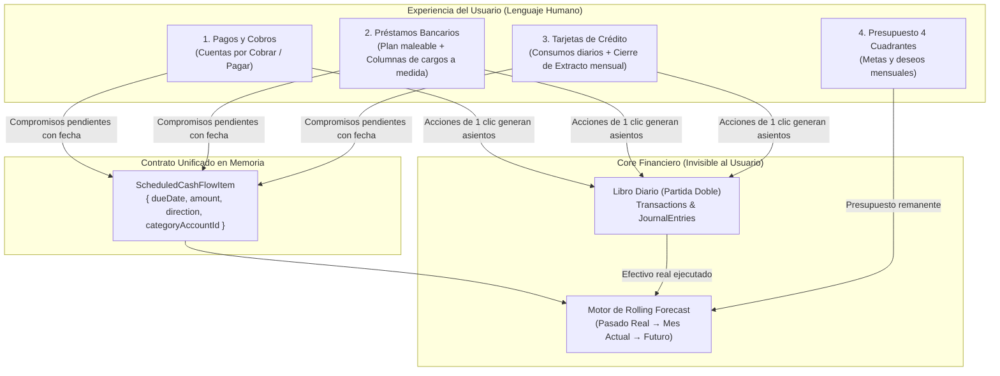

# Spec 00: Arquitectura Global de Subledgers y Contrato del Rolling Forecast

> **Principio Rector de Producto:**  
> ContaWave es una aplicación de hábito financiero cotidiano (2 minutos al día) para profesionales independientes, freelancers y micropymes. No intenta predecir ni imponer las reglas internas de cada banco, sino **representar fielmente la realidad contable del usuario** con el mínimo esfuerzo manual y proyectar su **Rolling Forecast (Flujo de Caja Proyectado)** y su **Patrimonio Neto**.

---

## 1. Mapa de Módulos Operativos y Separación de Responsabilidades



---

## 2. Contrato Unificado para el Rolling Forecast (`@sistema-contable/shared`)

El motor de Flujo de Caja Proyectado (`CashFlowStatementForecastUseCase`) y el Control Presupuestario (`GetBudgetControlUseCase`) **no conocen las tablas internas de ningún módulo**. Solo consumen una interfaz limpia: **`ScheduledCashFlowItem`**.

```typescript
export type CommitmentFlowDirection = 'INFLOW' | 'OUTFLOW';

export type CommitmentSourceType = 'COMMITMENT' | 'LOAN' | 'CREDIT_CARD';

/**
 * Ítem programado de flujo de caja que cualquier submódulo emite hacia el Rolling Forecast.
 * Representa una entrada o salida de dinero prevista en una fecha determinada.
 */
export interface ScheduledCashFlowItem {
  /** Fecha esperada de entrada o salida de dinero (YYYY-MM-DD) */
  dueDate: string;

  /** Período mensual derivado de dueDate (YYYY-MM) */
  periodName: string;

  /** Monto pendiente de cobro o pago (> 0, en moneda base) */
  amount: number;

  /** Dirección del flujo de efectivo */
  direction: CommitmentFlowDirection;

  /**
   * Cuenta contable (Ingreso, Gasto, Activo o Pasivo) a la que impacta este flujo.
   * Permite ubicar el monto en la fila correcta del Forecast y absorber su presupuesto.
   */
  categoryAccountId: string;

  /** Metadatos para desglose visual (drill-down por contacto, préstamo o tarjeta) */
  sourceType: CommitmentSourceType;
  sourceId: string;
  contactId?: string | null;
  contactName?: string | null;
  label: string;
}

/**
 * Puerto que implementan los 3 submódulos (Compromisos, Préstamos, Tarjetas)
 */
export interface CashFlowCommitmentSource {
  getScheduledCashFlowItems(
    userId: string,
    startDate: string,
    endDate: string,
  ): Promise<ScheduledCashFlowItem[]>;
}
```

### Cómo traduce cada módulo su realidad a `ScheduledCashFlowItem`:

| Módulo                         | Qué emite al Rolling Forecast                                                                                                                                                                                                                                                        | `direction`                                | `categoryAccountId`                                                                                                                                         |
| :----------------------------- | :----------------------------------------------------------------------------------------------------------------------------------------------------------------------------------------------------------------------------------------------------------------------------------- | :----------------------------------------- | :---------------------------------------------------------------------------------------------------------------------------------------------------------- |
| **1. Compromisos** (`spec-01`) | 1 `ScheduledCashFlowItem` por cada cuota pendiente (`amount - settled`) con `due_date` definido (`due_date IS NOT NULL`). Los compromisos sin fecha reflejan saldo vivo en el Balance General, pero no proyectan caja mensual ni absorben presupuesto.                               | `'INFLOW'` (Me deben) o `'OUTFLOW'` (Debo) | La categoría elegida al crear (ej. _Honorarios_, _Alquiler_), o la cuenta de sistema _Cuentas por Cobrar/Pagar_ si fue un préstamo de dinero.               |
| **2. Préstamos** (`spec-02`)   | Por cada cuota pendiente:<br/>• 1 ítem por el **Capital pendiente**<br/>• 1 ítem por cada **Rubro de cargo** (Interés, Seguro de Vida, etc.) agrupado por su cuenta de gasto.                                                                                                        | `'OUTFLOW'`                                | • Capital $\rightarrow$ Cuenta de Pasivo del préstamo (Cuadrante 4)<br/>• Cargos $\rightarrow$ Cuenta de Gasto asociada a cada columna (Cuadrante 2 / P&L). |
| **3. Tarjetas** (`spec-03`)    | • 1 ítem por el **Extracto emitido (`BILLED`)** pendiente de pago en su `due_date`.<br/>• 1 ítem por el **Ciclo abierto (`OPEN`)** (consumos del ciclo + cuotas del mes) en su `due_date` estimada.<br/>• 1 ítem en cada mes futuro por las **cuotas futuras de compras en cuotas**. | `'OUTFLOW'`                                | Cuenta de Pasivo de la tarjeta (Cuadrante 4).                                                                                                               |

---

## 3. Matemática del Rolling Forecast (Los 3 Tramos del Tiempo)

Para cada período mensual $M$ (`YYYY-MM`), cada cuenta/categoría $C$ y dirección de flujo $D \in \{\text{ENTRADA}, \text{SALIDA}\}$:

### A. Mes Pasado (`period.endDate < today`) — `REAL`

- Se lee únicamente el movimiento real de efectivo del período: `EjecutadoEnCaja(C, D, M)`.
- **Regla de Corte de Período:** Un mes solo pasa a estado `REAL` cuando ya cerró (`period.endDate < today`), corrigiendo la condición `period.startDate <= today` que convertía al mes en curso en `100% REAL` desde el día 1.
- **Regla Anti-Distorsión:** En el Flujo de Caja solo se computan como `EjecutadoEnCaja(C, D, M)` los asientos contables cuya transacción haya movido una cuenta líquida (`isCashOrBank = true`), separados según entrada o salida de dinero. Los devengos que no movieron banco (ej. anotar que un cliente te debe o comprar en cuotas con tarjeta) actualizan el Balance General y el Estado de Resultados, pero **no inflan las entradas/salidas de efectivo** hasta que efectivamente se cobran o pagan.

### B. Mes en Curso (`period.startDate <= today <= period.endDate`) — `ACTUAL`

- **Badge en UI:** Se muestra como **`ACTUAL`** (nunca bajo términos técnicos como _"HÍBRIDO"_).
- Combina automáticamente lo ya ejecutado en efectivo del día 1 a hoy con lo que aún falta por ocurrir hasta fin de mes, aplicando **la misma regla global a todas las partidas por igual**:

$$\text{Compromisos}(C, D, M) = \sum \text{ScheduledCashFlowItem}(C, D, M)$$

$$\text{FlujoMesActual}(C, D, M) = \max\Big(\text{Presupuesto}(C, D, M),\; \text{EjecutadoEnCaja}(C, D, M) + \text{Compromisos}(C, D, M)\Big)$$

- **Significado práctico:** En el mes `ACTUAL`, cada celda muestra directamente el **mayor** entre lo presupuestado para ese mes y lo que ya está en firme (`EjecutadoEnCaja + Compromisos con fecha en el mes`). Si el presupuesto no fue superado, evita duplicar lo ya gastado/cobrado sobre la meta del mes; si la ejecución o los compromisos ya superan lo presupuestado (o si no había presupuesto), la realidad manda y actualiza el flujo en vivo, sin exponer cálculos intermedios en la UI.

### C. Mes Futuro (`period.startDate > today`) — `PROYECTADO`

- **Badge en UI:** Se muestra como **`PROYECTADO`**.
- No tiene ejecución real todavía (`EjecutadoEnCaja = 0`):

$$\text{FlujoProyectado}(C, D, M) = \max\Big(\text{Presupuesto}(C, D, M),\; \text{Compromisos}(C, D, M)\Big)$$

### 3.1 Conexión con los 4 Cuadrantes del Presupuesto y Regla de Visibilidad

1. **Los 4 Cuadrantes como Motor de Proyección:**
   - **Cuadrante 1 (`Ingresos`):** $\rightarrow$ sección _(+) Ingresos Operativos_.
   - **Cuadrante 2 (`Egresos`):** $\rightarrow$ sección _(-) Egresos Operativos_.
   - **Cuadrante 3 (`Ahorros e Inversiones` - Activos)** y **Cuadrante 4 (`Deudas y Financiación` - Pasivos):** Se asignan a _(+) Entradas de Activo / Pasivo_ si su dirección es `INGRESO_EFECTIVO` (rescate, cobro de préstamo otorgado, desembolso) o a _(-) Salidas de Activo / Pasivo_ si su dirección es `EGRESO_EFECTIVO` (ej. aporte mensual presupuestado a una cuenta de ahorro como _Círculo de ahorro_, pago de tarjeta o préstamo).
2. **Regla de Visibilidad de Filas (Ocultar filas en cero por defecto):**
   - Para evitar ensuciar la matriz con decenas de cuentas de Activo y Pasivo en `0`, en cada sección solo se muestran por defecto las partidas que tengan un valor distinto de cero ($\neq 0$) en **al menos un mes** del horizonte consultado en esa dirección —ya provenga de asientos reales en el Libro Diario (`REAL`/`ACTUAL`), de lo presupuestado en los 4 cuadrantes, o de `ScheduledCashFlowItem` (Compromisos, Préstamos o Tarjetas).

---

## 4. Cuentas de Sistema Auto-Aprovisionadas (`SystemRole`) y Cuentas Iniciales

Para que el usuario **nunca tenga que crear ni elegir cuentas técnicas de control a mano**, `SystemRole` en `@sistema-contable/shared` se reserva exclusivamente para cuentas estructurales/de control creadas automáticamente por ContaWave:

1. `ACCOUNTS_RECEIVABLE` $\rightarrow$ **"Cuentas por Cobrar"** (`type: 'ASSET'`, `isCashOrBank: false`, `isControlAccount: true`, `controlType: 'RECEIVABLE'`).
2. `ACCOUNTS_PAYABLE` $\rightarrow$ **"Cuentas por Pagar"** (`type: 'LIABILITY'`, `isCashOrBank: false`, `isControlAccount: true`, `controlType: 'PAYABLE'`).

> **Categorías de Gasto Financiero (`EXPENSE`) sin candado `SystemRole`:**  
> La cuenta inicial **"Intereses y Cargos Financieros"** (`type: 'EXPENSE'`, `isCashOrBank: false`, `isControlAccount: false`) se aprovisiona como una cuenta de gasto **normal y libre** del Plan de Cuentas (sin `systemRole` bloqueante — se elimina la restricción rígida de `BANK_INTEREST_EXPENSE`). De este modo sigue siendo usable en Préstamos, Tarjetas, Transacción Rápida y Presupuestos, y el usuario puede renombrarla, editarla o sustituirla por sus propias categorías (ej. _Intereses Itaú_, _Seguro de Vida_, _IVA s/ Interés_).

### ¿Sub-cuentas físicas por Contacto o Desglose Virtual en Árbol?

- **Decisión de Arquitectura:** **NO** se crea una fila física en la tabla `accounts` por cada contacto, porque:
  1. Contaminaría todos los selectores de cuentas del Libro Diario y añadiría decenas de filas de personas en la Matriz de Presupuestos.
  2. Una misma persona (ej. un socio o hermano) hoy puede deberte (`ASSET`) y mañana tú deberle (`LIABILITY`), lo que obligaría a duplicar cuentas contables.
- **Cómo se visualiza en Reportes (Sub-filas Virtuales y Lineamientos UI de la Matriz):**
  - En el **Balance General** y en el **Flujo de Caja**, las cuentas padre _"Cuentas por Cobrar"_ y _"Cuentas por Pagar"_ muestran un botón desplegable `▸` que renderiza dinámicamente el saldo vivo agrupado por `contact_id` (ej. `├─ Don José: ₲ 4.000.000`, `└─ Hermana: ₲ 500.000`). En el Balance General se incluyen todos los compromisos vivos (con y sin fecha de vencimiento), mientras que en el Flujo de Caja Proyectado solo entran los que tienen `due_date` dentro del período. El usuario obtiene la misma claridad visual de una sub-cuenta por contacto, manteniendo su Plan de Cuentas 100% limpio.
  - **Celdas uniformes en `ACTUAL`:** Todas las celdas de la columna `ACTUAL` se muestran limpias y homogéneas, **sin subrayados punteados ni popovers aislados** exclusivos para compromisos, ya que toda la matriz aplica la misma regla global.
  - **Jerarquía tipográfica uniforme:** Las partidas con desglose desplegable (`▸ Cuentas por Cobrar` y `▸ Cuentas por Pagar`) mantienen exactamente el mismo peso tipográfico (`font-medium` / regular, **sin negrita**) que el resto de las partidas de primer nivel. La negrita se reserva exclusivamente para las filas de totales estructurales (_Saldo Inicial_, _Total Entradas_, _Total Salidas_, _Flujo Neto_ y _SALDO FINAL DE CAJA_).
