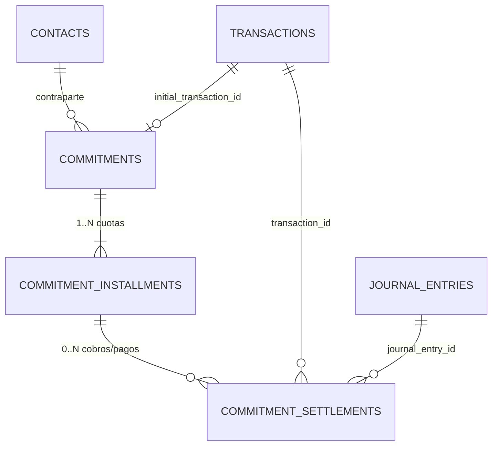

# Spec 01: Pagos y Cobros (Cuentas por Cobrar y Cuentas por Pagar)

> **Objetivo del Módulo:**  
> Unificar bajo una sola experiencia ultraliviana cualquier dinero que le deban al usuario (un proyecto freelance en 4 pagos, un préstamo a un familiar) o que el usuario deba a terceros (un proveedor, un servicio anual en cuotas), proyectando su impacto exacto en el **Rolling Forecast** y permitiendo liquidarlo en **1 clic**.

---

## 1. Experiencia de Usuario (Cero Jerga Contable)

### 1.1 Alta de un Compromiso (3 preguntas simples)

El usuario abre **"Nuevo Compromiso"** y elige entre dos pestañas claras: **🟢 Me deben (Cobro futuro)** o **🔴 Debo (Pago futuro)**.

Completa únicamente:

1. **¿Quién?** Selector/creación rápida de contacto (ej. _"Don José"_, _"Hermana"_, _"Proveedor Hosting"_) + descripción corta.
2. **¿Cuánto y cuándo?** Monto total y cantidad de cuotas (por defecto `1 pago` con fecha elegida o marcado como **"Sin fecha definida"** para compromisos abiertos; si elige `N cuotas`, el sistema divide el monto en una tabla previa editable donde puede ajustar montos y fechas).
3. **¿Cómo se originó esto?** (3 opciones en lenguaje humano):

| Opción en UI                                    | Cuándo la usa el usuario                                                                                               | Asiento automático bajo el capó (`'INFLOW'`)                      | Asiento automático bajo el capó (`'OUTFLOW'`)                    |
| :---------------------------------------------- | :--------------------------------------------------------------------------------------------------------------------- | :---------------------------------------------------------------- | :--------------------------------------------------------------- |
| **A. Por un ingreso / gasto** _(Por defecto)_   | Vendió un servicio a crédito o contrató un gasto a pagar después. Elige la categoría (ej. _Honorarios_ o _Marketing_). | `Dr Cuentas por Cobrar` / `Cr [Categoría Ingreso]`                | `Dr [Categoría Gasto]` / `Cr Cuentas por Pagar`                  |
| **B. Salió / Entró de mi cuenta hoy**           | Le prestó plata hoy a un familiar desde su banco, o recibió hoy plata prestada de alguien. Elige la cuenta bancaria.   | `Dr Cuentas por Cobrar` / `Cr [Banco elegido]`                    | `Dr [Banco elegido]` / `Cr Cuentas por Pagar`                    |
| **C. Ajuste patrimonial / Ya existía de antes** | Registra un compromiso previo o un ajuste patrimonial sin afectar su banco ni sus ingresos/gastos del mes.             | `Dr Cuentas por Cobrar` / `Cr Capital` _(systemRole `'CAPITAL'`)_ | `Dr Capital` _(systemRole `'CAPITAL'`)_ / `Cr Cuentas por Pagar` |

> **Etiquetas limpias en UI (Cero Jerga):** En el listado de compromisos, los badges deben mostrar lenguaje humano según el origen: el nombre de la categoría elegida para `'CATEGORY'` (ej. _Honorarios_), _"Préstamo de dinero"_ (o la cuenta bancaria) para `'CASH_TRANSFER'`, y _"Ajuste patrimonial"_ (o sin badge) para `'CAPITAL_ADJUSTMENT'`. Nunca exponer nombres técnicos como `CAPITAL_ADJUSTMENT` o `Categoría: Efectivo`.

### 1.2 Desglose por Contacto sin Ensuciar el Plan de Cuentas

- Internamente todos los compromisos imputan a las cuentas de sistema `Cuentas por Cobrar` (`ACCOUNTS_RECEIVABLE`) y `Cuentas por Pagar` (`ACCOUNTS_PAYABLE`).
- En el **Balance General** y en el **Flujo de Caja**, al expandir `▸ Cuentas por Cobrar`, la interfaz muestra las **sub-filas virtuales por contacto** (calculadas agregando los saldos pendientes por `contact_id`), logrando el efecto visual de tener una sub-cuenta por persona sin llenar de basura los selectores de cuentas ni la grilla de presupuestos.

---

## 2. Modelo de Datos Relacional (4 Tablas)



### 2.1 `contacts` (Directorio de Personas y Empresas)

| Columna      | Tipo                   | Descripción                                                              |
| :----------- | :--------------------- | :----------------------------------------------------------------------- |
| `id`         | `UUID` (PK)            | Identificador único                                                      |
| `user_id`    | `UUID` (FK `users.id`) | Dueño del directorio (`ON DELETE CASCADE`)                               |
| `name`       | `VARCHAR(120)`         | Nombre visible (ej. _"Don José"_, _"Hermana"_) — `UNIQUE(user_id, name)` |
| `notes`      | `TEXT NULL`            | Teléfono, alias bancario o nota libre opcional                           |
| `created_at` | `TIMESTAMPTZ`          | Fecha de alta                                                            |

### 2.2 `commitments` (Cabecera del Compromiso)

| Columna                  | Tipo                           | Descripción                                                                                                           |
| :----------------------- | :----------------------------- | :-------------------------------------------------------------------------------------------------------------------- |
| `id`                     | `UUID` (PK)                    | Identificador único                                                                                                   |
| `user_id`                | `UUID` (FK `users.id`)         | Usuario propietario                                                                                                   |
| `contact_id`             | `UUID` (FK `contacts.id`)      | Persona o entidad asociada (`ON DELETE RESTRICT`)                                                                     |
| `direction`              | `VARCHAR(10)`                  | `'INFLOW'` (Me deben) \| `'OUTFLOW'` (Debo)                                                                           |
| `origin_type`            | `VARCHAR(20)`                  | `'CATEGORY'` \| `'CASH_TRANSFER'` \| `'CAPITAL_ADJUSTMENT'`                                                           |
| `description`            | `VARCHAR(255)`                 | Concepto (ej. _"Desarrollo web e-commerce"_)                                                                          |
| `total_amount`           | `NUMERIC(18, 4)`               | Monto total pactado (`> 0`)                                                                                           |
| `category_account_id`    | `UUID NULL` (FK `accounts.id`) | Cuenta de Ingreso/Gasto asociada (usada para absorber presupuesto en el Forecast; `NULL` si fue préstamo de efectivo) |
| `control_account_id`     | `UUID` (FK `accounts.id`)      | Apunta internamente a la cuenta de sistema `ACCOUNTS_RECEIVABLE` o `ACCOUNTS_PAYABLE`                                 |
| `initial_transaction_id` | `UUID` (FK `transactions.id`)  | Asiento contable de origen en el Ledger                                                                               |
| `created_at`             | `TIMESTAMPTZ`                  | Fecha de creación                                                                                                     |

### 2.3 `commitment_installments` (Cuotas / Vencimientos)

| Columna              | Tipo                         | Descripción                                                                      |
| :------------------- | :--------------------------- | :------------------------------------------------------------------------------- |
| `id`                 | `UUID` (PK)                  | Identificador único de la cuota                                                  |
| `commitment_id`      | `UUID` (FK `commitments.id`) | Cabecera (`ON DELETE CASCADE`)                                                   |
| `installment_number` | `INT`                        | Número de cuota (`1, 2, ... N`)                                                  |
| `due_date`           | `DATE NULL`                  | Fecha esperada de cobro/pago (`NULL` si es indefinida; reprogramable libremente) |
| `amount`             | `NUMERIC(18, 4)`             | Monto nominal de la cuota (`> 0`)                                                |

> **Invariante Anti-Drift:** No existe columna `paid_amount` ni `status` estático en base de datos. El monto pagado y el estado (`PENDING`, `PARTIAL`, `PAID`, `OVERDUE`) se calculan siempre sumando las filas activas de `commitment_settlements` cuya transacción en `transactions` tenga `status = 'POSTED'`. Si `due_date IS NULL`, la cuota **nunca** pasa a `OVERDUE` (solo `PENDING`, `PARTIAL` o `PAID`).

### 2.4 `commitment_settlements` (Liquidaciones / Cobros y Pagos)

| Columna            | Tipo                                     | Descripción                                                                  |
| :----------------- | :--------------------------------------- | :--------------------------------------------------------------------------- |
| `id`               | `UUID` (PK)                              | Identificador único de la imputación                                         |
| `installment_id`   | `UUID` (FK `commitment_installments.id`) | Cuota que se está cancelando (`ON DELETE RESTRICT`)                          |
| `transaction_id`   | `UUID` (FK `transactions.id`)            | Cabecera del asiento en el Ledger (`ON DELETE RESTRICT`)                     |
| `journal_entry_id` | `UUID` (FK `journal_entries.id`)         | Línea exacta del asiento que tocó `ACCOUNTS_RECEIVABLE` / `ACCOUNTS_PAYABLE` |
| `settlement_type`  | `VARCHAR(15)`                            | `'CASH'` (Cobro/Pago real) \| `'FORGIVEN'` (Condonado / Dado por perdido)    |
| `amount`           | `NUMERIC(18, 4)`                         | Importe aplicado a esta cuota (`> 0`)                                        |
| `settled_at`       | `DATE`                                   | Fecha efectiva del cobro/pago                                                |
| `created_at`       | `TIMESTAMPTZ`                            | Timestamp de auditoría                                                       |

---

## 3. Casos de Uso y Endpoints REST

### 3.1 Crear Compromiso (`POST /api/commitments`)

- **Caso de Uso:** `CreateCommitmentUseCase`
- **Flujo Atómico (`QueryRunner`):**
  1. Obtiene (o auto-crea) la cuenta de sistema `ACCOUNTS_RECEIVABLE` o `ACCOUNTS_PAYABLE` del usuario.
  2. Crea el asiento inicial en `transactions` y `journal_entries` según `originType` (`CATEGORY`, `CASH_TRANSFER` o `CAPITAL_ADJUSTMENT` contra `systemRole: 'CAPITAL'`) y actualiza `BalanceUpdateService`.
  3. Persiste `commitments` y sus $N$ `commitment_installments`.

### 3.2 Cobrar o Pagar en 1 Clic (`POST /api/commitments/installments/:id/settle`)

- **Caso de Uso:** `SettleCommitmentInstallmentUseCase`
- **Request DTO:**
  ```typescript
  export interface SettleCommitmentInstallmentRequest {
    amount: number; // Precargado en UI con el saldo pendiente de la cuota
    cashAccountId: string; // Cuenta bancaria o billetera (isCashOrBank = true)
    date: string; // YYYY-MM-DD (por defecto hoy)
    newDueDateForRemainder?: string; // Opcional si pagó menos del total y quiere patear el resto
  }
  ```
- **Flujo Atómico (`QueryRunner`):**
  1. Verifica que `amount <= pendingAmount` de la cuota.
  2. Si `direction === 'INFLOW'`, asienta: `Dr [Banco elegido] / Cr Cuentas por Cobrar`.
  3. Si `direction === 'OUTFLOW'`, asienta: `Dr Cuentas por Pagar / Cr [Banco elegido]`.
  4. Inserta el registro en `commitment_settlements` apuntando al `journal_entry_id` que redujo la cuenta de control.
  5. Si fue un pago parcial y el usuario indicó `newDueDateForRemainder`, actualiza `due_date` de la cuota para que el saldo restante se proyecte en la nueva fecha (si la cuota no tenía fecha y no se indicó una nueva, continúa con `due_date = NULL`).

### 3.3 Dar por Perdido / Condonar (`POST /api/commitments/installments/:id/forgive`)

- **Caso de Uso:** `ForgiveCommitmentInstallmentUseCase`
- **Qué resuelve:** _"Le presté 500k a mi hermana y ya sé que no me los va a devolver"_.
- **Flujo Atómico:**
  1. Asienta por el saldo pendiente sin tocar bancos:
     - Si era `INFLOW` y tenía `category_account_id`: revierte contra esa categoría; si no tenía categoría (préstamo de dinero), debita `Capital` (o una cuenta de gasto elegida) contra `Cr Cuentas por Cobrar`.
  2. Crea el `commitment_settlement` con `settlement_type = 'FORGIVEN'`. La cuota queda saldada y sale del Rolling Forecast.

### 3.4 Reprogramar Fecha (`PATCH /api/commitments/installments/:id`)

- Cambia únicamente `due_date` —incluyendo asignar fecha a un compromiso abierto (`NULL` $\rightarrow$ `YYYY-MM-DD`) o quitarla (`YYYY-MM-DD` $\rightarrow$ `NULL`)— y opcionalmente el monto si aún no tuvo pagos. Cero impacto en el Ledger; actualiza instantáneamente el mes en que cae la plata en el Rolling Forecast.

### 3.5 Deshacer Cobro/Pago (`POST /api/commitments/settlements/:id/undo`)

- Llama a `ReverseTransactionUseCase` sobre `settlement.transaction_id` dentro de la misma transacción de base de datos. Al pasar la transacción a `status = 'REVERSED'`, el cálculo derivado devuelve la cuota a `PENDING` o `PARTIAL` automáticamente.

---

## 4. Integración con el Rolling Forecast (`ScheduledCashFlowItem`)

El adaptador `CommitmentCashFlowAdapter` consulta todas las cuotas de `commitment_installments` cuyo saldo pendiente (`amount - SUM(active_settlements.amount)`) sea mayor a `0`, que tengan fecha definida (`due_date IS NOT NULL`) y estén dentro del rango `[startDate, endDate]`:

- **`dueDate`**: `installment.dueDate`
- **`amount`**: `pendingAmount`
- **`direction`**: `commitment.direction` (`'INFLOW'` o `'OUTFLOW'`)
- **`categoryAccountId`**: `commitment.categoryAccountId ?? commitment.controlAccountId`
- **`contactId` / `contactName`**: Datos del contacto para mostrar sub-filas virtuales bajo _Cuentas por Cobrar / Pagar_.

> **Compromisos sin fecha (`due_date IS NULL`):** No emiten `ScheduledCashFlowItem` hacia el Rolling Forecast ni absorben presupuesto mensual, pero mantienen su saldo vivo en el Balance General (_Cuentas por Cobrar / Pagar_) y en la vista de Compromisos bajo un agrupamiento neutro (_"Sin fecha / Abiertos"_) hasta que se liquiden o se les asigne fecha.
