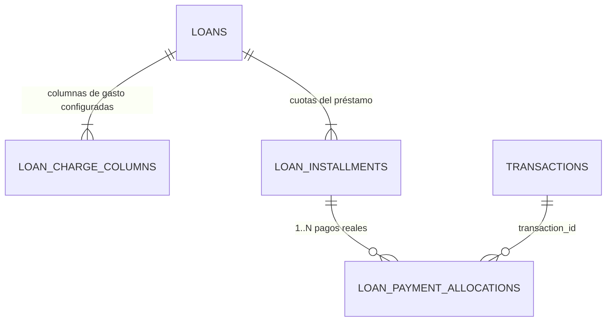

# Spec 02: Préstamos y Deuda Bancaria (Plan Maleable y Rubros a Medida)

> **Filosofía del Módulo:**  
> ContaWave no impone la matemática de ningún banco. Usa una calculadora financiera (Monto, Tasa y Plazo) únicamente como **asistente inicial para ahorrarle trabajo al usuario**, generando una tabla de cuotas 100% maleable a la que el usuario puede **agregar sus propias columnas de cargos** (Seguro de Vida, IVA, Aporte Cooperativa, Gastos Administrativos) y **reajustar en cualquier momento** a lo largo de la vida del préstamo conforme su realidad bancaria cambie.

---

## 1. Experiencia de Usuario: Wizard de Creación y Onboarding

### Paso 1: Los 3 Datos Base + Modo (Nuevo vs. En Curso)

El usuario ingresa solo lo esencial para que ContaWave le arme el borrador del plan:

1. **Nombre del Préstamo:** Ej. _"Préstamo Auto Itaú"_.
2. **Los 3 datos generadores:**
   - **Capital original del préstamo:** Ej. `₲ 60.000.000`
   - **Tasa de interés anual (%):** Ej. `13,5%`
   - **Plazo total:** Ej. `24 cuotas` + Fecha de 1ra cuota.
3. **¿Es un préstamo nuevo o ya lo venías pagando?**
   - **🟢 Nuevo desembolso:** Elige en qué cuenta bancaria cayó la plata hoy $\rightarrow$ Al confirmar, asienta `Dr Banco / Cr Pasivo Préstamo`.
   - **🔵 Ya lo venía pagando (Onboarding):**
     - Elige en un selector: **_"¿Desde qué número de cuota vas a registrar en ContaWave?"_** $\rightarrow$ Ej. `Cuota 13 de 24` (las cuotas 1 a 12 ya fueron pagadas en el pasado).
     - El sistema calcula al instante la tabla completa de 24 cuotas, descarta las 12 primeras y le muestra solo las **cuotas 13 a 24**, sumando automáticamente el capital vivo restante (ej. `₲ 32.150.000`) que irá al asiento de apertura (`Dr Capital / Cr Pasivo Préstamo`).

---

### Paso 2: La Grilla de Previsualización Maleable (Columnas Personalizables)

Antes de guardar (y también en cualquier momento futuro desde el botón _"Editar Plan de Pagos"_), el usuario ve la tabla interactiva de cuotas:

```text
┌────────────────────────────────────────────────────────────────────────────────────────┐
│  📋 Plan de Pagos — Préstamo Auto Itaú (Cuotas 13 a 24)        [+ Agregar Columna ▾]   │
├───────┬──────────────┬─────────────────┬─────────────────┬─────────────────┬───────────┤
│ Cuota │ Vencimiento  │ Capital (Deuda) │ Interés         │ Seguro de Vida  │ Total     │
│       │              │ → Pasivo Prést. │ → Int. y Cargos │ → Seguros (Gto) │ a Pagar   │
├───────┼──────────────┼─────────────────┼─────────────────┼─────────────────┼───────────┤
│ #13   │ [15/11/2026] │ [ ₲ 2.450.000 ] │ [ ₲   360.000 ] │ [ ₲    45.000 ] │ 2.855.000 │
│ #14   │ [15/12/2026] │ [ ₲ 2.478.000 ] │ [ ₲   332.000 ] │ [ ₲    45.000 ] │ 2.855.000 │
│ ...   │ ...          │ ...             │ ...             │ ...             │ ...       │
└───────┴──────────────┴─────────────────┴─────────────────┴─────────────────┴───────────┘
  Capital total que irá a tu Balance General hoy: ₲ 32.150.000
```

#### Capacidades de la Grilla Maleable:

1. **`[ + Agregar Columna ]` (Rubros a medida del banco):**
   - Por defecto la tabla nace con `Capital` + `Interés`.
   - Si el banco o cooperativa cobra _Seguro de Vida_, _IVA_, _Gastos Administrativos_ o _Solidaridad_, el usuario hace clic en **`+ Agregar Columna`**, le pone nombre (ej. _"Seguro de Vida"_), elige a qué categoría de Gasto va (por defecto _"Intereses y Cargos Financieros"_, o puede elegir _"Seguros"_), y puede autocompletar un monto fijo para todas las filas con 1 clic o editar celda por celda.
2. **Edición libre de cualquier celda o fecha:**
   - Si el banco usa sistema alemán, cuota balón o fechas irregulares, el usuario edita directamente las celdas de la tabla. Lo que queda escrito en esa tabla es la **verdad de proyección** para el Rolling Forecast.

---

## 2. Evolución del Plan en el Tiempo (Cuando la Realidad Cambia)

Un préstamo rara vez se mantiene estático durante 3 años. ContaWave resuelve los dos tipos de cambios reales sin banderas raras (`is_superseded` eliminado):

### Caso A: Variación puntual al pagar la cuota del mes (1 Clic)

Cuando el usuario presiona **"Pagar Cuota #13"**, el modal le precarga los valores que él definió en esa fila (`Capital: 2.450.000`, `Interés: 360.000`, `Seguro: 45.000`).

- Si ese mes pagó 3 días tarde y el banco le debitó `₲ 20.000` más de interés moratorio, el usuario cambia `Interés` a `380.000` en el modal y confirma.
- El capital (`2.450.000`) baja exactamente la deuda prevista en el Balance General, y los `380.000` van a gasto financiero real.

### Caso B: Modificar o Recalcular el Plan de Pagos Restante

Si el usuario hace una **amortización extraordinaria de capital**, o el banco le cambia la tasa/seguro a mitad del préstamo:

1. El usuario abre **"Editar / Reajustar Plan Pendiente"**.
2. Las cuotas ya pagadas (`PAID`) quedan bloqueadas arriba como historial intocable.
3. Todas las cuotas pendientes (`PENDING` o `PARTIAL`) son **100% editables en vivo**:
   - Puede usar el asistente _"Recalcular cuotas pendientes"_ (ingresando la nueva tasa, nuevo plazo o el capital remanente tras un pago anticipado).
   - O puede editar a mano los montos y fechas de las cuotas que le quedan.
4. **Sincronización Automática de Balance:** Si el usuario corrige el capital pendiente de su plan porque notó una diferencia con el saldo que informa su banco, el sistema ajusta automáticamente el asiento o genera un ajuste contra `Capital` / `Cargos Financieros` para que se cumpla siempre la regla de oro:
   $$\text{Saldo Cuenta Pasivo en Balance General} \equiv \sum_{\text{cuotas pendientes}} \text{Capital Pendiente}$$

---

## 3. Modelo de Datos Relacional (Limpio y Extensible)



### 3.1 `loans` (Cabecera del Préstamo)

| Columna                    | Tipo                           | Descripción                                                                          |
| :------------------------- | :----------------------------- | :----------------------------------------------------------------------------------- |
| `id`                       | `UUID` (PK)                    | Identificador único                                                                  |
| `user_id`                  | `UUID` (FK `users.id`)         | Propietario                                                                          |
| `contact_id`               | `UUID NULL` (FK `contacts.id`) | Banco o cooperativa opcional                                                         |
| `name`                     | `VARCHAR(120)`                 | Ej. _"Préstamo Auto Itaú"_                                                           |
| `initial_principal`        | `NUMERIC(18, 4)`               | Capital reconocido al crear el préstamo en ContaWave                                 |
| `annual_rate`              | `NUMERIC(8, 4)`                | Tasa anual de referencia usada en el asistente (%)                                   |
| `start_installment_number` | `INT` (Default `1`)            | Número de la primera cuota cargada (ej. `13` si fue un onboarding en la cuota 13/24) |
| `total_installments_count` | `INT`                          | Plazo total nominal (ej. `24`)                                                       |
| `liability_account_id`     | `UUID` (FK `accounts.id`)      | Cuenta de Pasivo auto-creada para este préstamo                                      |
| `initial_transaction_id`   | `UUID` (FK `transactions.id`)  | Asiento de desembolso (`Dr Banco`) o de onboarding (`Dr Capital`)                    |
| `status`                   | `VARCHAR(15)`                  | `'ACTIVE'` \| `'SETTLED'`                                                            |

### 3.2 `loan_charge_columns` (Definición de Columnas de Cargos del Préstamo)

Define qué columnas adicionales (además de `Capital`) tiene la tabla de este préstamo:
| Columna | Tipo | Descripción |
| :--- | :--- | :--- |
| `id` | `UUID` (PK) | Identificador de la columna (ej. columna _"Interés"_, columna _"Seguro de Vida"_) |
| `loan_id` | `UUID` (FK `loans.id`) | Préstamo al que pertenece (`ON DELETE CASCADE`) |
| `name` | `VARCHAR(80)` | Etiqueta visible: _"Interés"_, _"Seguro de Vida"_, _"IVA"_, _"Solidaridad"_ |
| `expense_account_id` | `UUID` (FK `accounts.id`) | Cuenta de Gasto (`EXPENSE`) donde impacta en el P&L y en el Forecast |
| `sort_order` | `INT` | Orden de aparición en la tabla |

### 3.3 `loan_installments` (Cuotas del Plan de Pagos)

| Columna              | Tipo                   | Descripción                                                                                                                         |
| :------------------- | :--------------------- | :---------------------------------------------------------------------------------------------------------------------------------- |
| `id`                 | `UUID` (PK)            | Identificador único de la cuota                                                                                                     |
| `loan_id`            | `UUID` (FK `loans.id`) | Préstamo padre (`ON DELETE CASCADE`)                                                                                                |
| `installment_number` | `INT`                  | Número real de cuota (ej. `13, 14... 24`)                                                                                           |
| `due_date`           | `DATE`                 | Fecha esperada de pago                                                                                                              |
| `principal_amount`   | `NUMERIC(18, 4)`       | Porción de **Capital** que amortiza la deuda en Pasivo                                                                              |
| `charges_json`       | `JSONB`                | Mapa `{ [chargeColumnId: string]: number }` con los montos previstos de cada columna de cargo (Interés, Seguro, etc.) en esta cuota |

### 3.4 `loan_payment_allocations` (Pagos Aplicados — Relación `1:N`)

| Columna                      | Tipo                               | Descripción                                                                                  |
| :--------------------------- | :--------------------------------- | :------------------------------------------------------------------------------------------- |
| `id`                         | `UUID` (PK)                        | Identificador único del pago                                                                 |
| `installment_id`             | `UUID` (FK `loan_installments.id`) | Cuota que se está pagando (**sin `UNIQUE`**, soporta pagos parciales)                        |
| `transaction_id`             | `UUID` (FK `transactions.id`)      | Asiento contable en el Ledger (`ON DELETE RESTRICT`)                                         |
| `principal_journal_entry_id` | `UUID` (FK `journal_entries.id`)   | Línea del asiento que redujo `liability_account_id`                                          |
| `allocated_principal`        | `NUMERIC(18, 4)`                   | Capital efectivamente amortizado en este pago (`>= 0`)                                       |
| `allocated_charges_json`     | `JSONB`                            | Mapa `{ [chargeColumnId: string]: number }` con los cargos reales pagados en este movimiento |
| `paid_at`                    | `DATE`                             | Fecha efectiva del pago                                                                      |

---

## 4. Integración con el Rolling Forecast (`ScheduledCashFlowItem`)

Por cada `loan_installment` cuyo capital pendiente (`principal_amount - SUM(allocated_principal)`) sea mayor a `0`, el adaptador `LoanCashFlowAdapter` emite hacia el Rolling Forecast en la fecha `due_date`:

1. **Un `ScheduledCashFlowItem` por el Capital Pendiente:**
   - `amount`: `pendingPrincipal`
   - `direction`: `'OUTFLOW'`
   - `categoryAccountId`: `loan.liability_account_id` (Impacta **Salidas de Activo/Pasivo — Cuadrante 4**).
2. **Un `ScheduledCashFlowItem` por cada Columna de Cargo configurada (`loan_charge_columns`):**
   - `amount`: `scheduledCharge[col.id] - paidCharge[col.id]`
   - `direction`: `'OUTFLOW'`
   - `categoryAccountId`: `col.expense_account_id` (Impacta exactamente la cuenta de Gasto elegida por el usuario en **Egresos Operativos — Cuadrante 2** y en el **Estado de Resultados Proyectado**).
