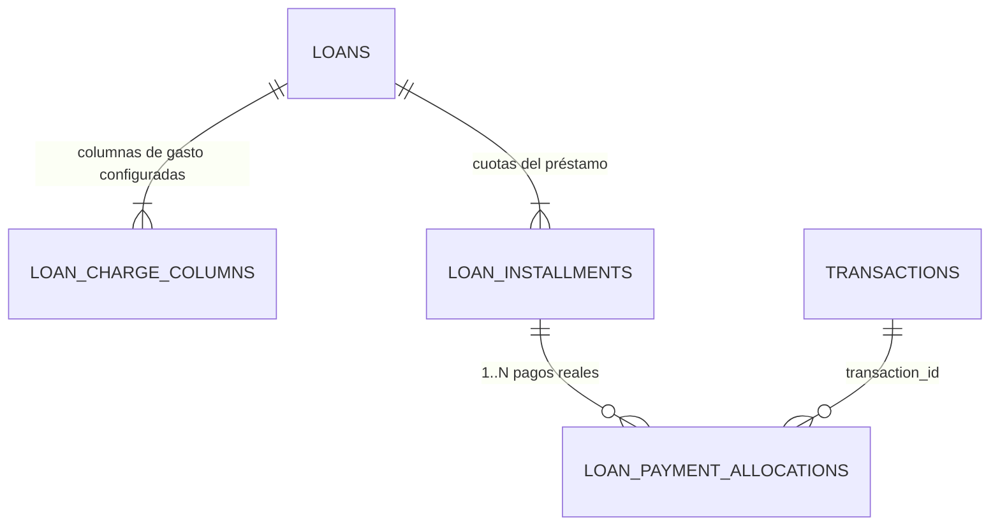

# Spec 02: Préstamos y Deuda Bancaria (Plan Maleable y Rubros a Medida)

> **Filosofía del Módulo:**  
> ContaWave no impone la matemática de ningún banco. Usa una calculadora financiera (Monto, Tasa y Plazo) únicamente como **asistente inicial para ahorrarle trabajo al usuario**, generando una tabla de cuotas 100% maleable a la que el usuario puede **agregar sus propias columnas de cargos** (Seguro de Vida, IVA, Aporte Cooperativa, Gastos Administrativos) y **reajustar en cualquier momento** a lo largo de la vida del préstamo conforme su realidad bancaria cambie.

---

## 1. Experiencia de Usuario: Wizard de Creación y Onboarding

### Paso 1: Los 3 Datos Base + Modo (Nuevo vs. En Curso)

El usuario ingresa solo lo esencial para que ContaWave le arme el borrador del plan:

1. **Nombre del Préstamo:** Ej. _"Préstamo Auto Itaú"_ (es la identidad del préstamo y de su cuenta de Pasivo dedicada; **no** se vincula al directorio `contacts`).
2. **Los 3 datos generadores + Moneda:**
   - **Capital original del préstamo:** Ej. `₲ 60.000.000` (en la moneda elegida, por defecto la moneda base del usuario).
   - **Tasa de interés anual (%):** Ej. `13,5%`
   - **Plazo total:** Ej. `24 cuotas` + Fecha de 1ra cuota.
3. **¿Es un préstamo nuevo o ya lo venías pagando? (+ Fecha de apertura/desembolso):**
   - **🟢 Nuevo desembolso:** Elige en qué cuenta bancaria cayó la plata y la **fecha del desembolso** (`opening_date`, por defecto hoy) $\rightarrow$ Al confirmar, asienta `Dr Banco / Cr Pasivo Préstamo` (y opcionalmente recuerda esa cuenta como cuenta habitual de pago).
   - **🔵 Ya lo venía pagando (Onboarding):**
     - Elige en un selector dinámico (`1..N`): **_"¿Desde qué número de cuota vas a registrar en ContaWave?"_** $\rightarrow$ Ej. `Cuota 13 de 24` (las cuotas 1 a 12 ya fueron pagadas en el pasado).
     - Elige la **fecha de apertura** (`opening_date`, por defecto hoy) y opcionalmente una **cuenta bancaria habitual de pago** (`default_payment_account_id`, solo sugerencia editable para futuras cuotas).
     - El sistema calcula al instante la tabla completa de 24 cuotas, descarta las 12 primeras y le muestra solo las **cuotas 13 a 24**, sumando automáticamente el capital vivo restante (ej. `₲ 32.150.000`) que irá al asiento de apertura (`Dr Capital / Cr Pasivo Préstamo`).

---

### Paso 2: La Grilla de Previsualización Maleable (Columnas Personalizables)

Antes de guardar (y también en cualquier momento futuro desde el botón _"Editar Plan de Pagos"_), el usuario ve la tabla interactiva de cuotas:

```text
┌────────────────────────────────────────────────────────────────────────────────────────┐
│  📋 Plan de Pagos — Préstamo Auto Itaú (Cuotas 13 a 24)        [+ Agregar Columna ▾]   │
├───────┬──────────────┬─────────────────┬─────────────────┬─────────────────┬───────────┤
│ Cuota │ Vencimiento  │ Capital (Deuda) │ Interés         │ Seguro de Vida  │ Total     │
│       │              │ → Pasivo Prést. │ → Int. y Cargos │ → Seguros (Gto) │ a Pagar   │
├───────┼──────────────┼─────────────────┼─────────────────┼─────────────────┼───────────┤
│ #13   │ [15/11/2026] │ [ ₲ 2.450.000 ] │ [ ₲   360.000 ] │ [ ₲    45.000 ] │ 2.855.000 │
│ #14   │ [15/12/2026] │ [ ₲ 2.478.000 ] │ [ ₲   332.000 ] │ [ ₲    45.000 ] │ 2.855.000 │
│ ...   │ ...          │ ...             │ ...             │ ...             │ ...       │
└───────┴──────────────┴─────────────────┴─────────────────┴─────────────────┴───────────┘
  Capital total que irá a tu Balance General hoy: ₲ 32.150.000
```

#### Capacidades de la Grilla Maleable:

1. **`[ + Agregar Columna ]` (Rubros a medida del banco):**
   - Por defecto la tabla nace con `Capital` + `Interés`.
   - Si el banco o cooperativa cobra _Seguro de Vida_, _IVA_, _Gastos Administrativos_ o _Solidaridad_, el usuario hace clic en **`+ Agregar Columna`**, le pone nombre (ej. _"Seguro de Vida"_), elige o crea al vuelo a qué categoría de Gasto va (desde un selector filtrado por categorías financieras/de préstamo para no mezclarlo con gastos cotidianos como _Comida_), y puede autocompletar un monto fijo para todas las filas con 1 clic o editar celda por celda.
2. **Edición libre de cualquier celda o fecha:**
   - Si el banco usa sistema alemán, cuota balón o fechas irregulares, el usuario edita directamente las celdas de la tabla. Lo que queda escrito en esa tabla es la **verdad de proyección** para el Rolling Forecast.

---

## 2. Evolución del Plan en el Tiempo (Cuando la Realidad Cambia)

Un préstamo rara vez se mantiene estático durante 3 años. ContaWave resuelve los dos tipos de cambios reales sin banderas raras (`is_superseded` eliminado):

### Caso A: Variación puntual al pagar la cuota del mes (1 Clic)

Cuando el usuario presiona **"Pagar Cuota #13"**, el modal le precarga los valores que él definió en esa fila (`Capital: 2.450.000`, `Interés: 360.000`, `Seguro: 45.000`).

- Si ese mes pagó 3 días tarde y el banco le debitó `₲ 20.000` más de interés moratorio, el usuario cambia `Interés` a `380.000` en el modal y confirma.
- El capital (`2.450.000`) baja exactamente la deuda prevista en el Balance General, y los `380.000` van a gasto financiero real.

### Caso B: Modificar o Recalcular el Plan de Pagos Restante

Si el usuario hace una **amortización extraordinaria de capital**, o el banco le cambia la tasa/seguro a mitad del préstamo:

1. El usuario abre **"Editar / Reajustar Plan Pendiente"**.
2. Las cuotas ya pagadas (`PAID`) quedan bloqueadas arriba como historial intocable.
3. Todas las cuotas pendientes (`PENDING` o `PARTIAL`) son **100% editables en vivo** (con la cota mínima obligatoria en cuotas `PARTIAL` de que `principal_amount >= SUM(allocated_principal)` ya pagado):
   - Puede usar el asistente _"Recalcular cuotas pendientes"_ (ingresando la nueva tasa, nuevo plazo o el capital remanente tras un pago anticipado).
   - O puede editar a mano los montos y fechas de las cuotas que le quedan.
4. **Sincronización Automática de Balance (3 opciones, igual que Compromisos):** Si el capital pendiente total del nuevo plan difiere del saldo vivo actual ($\Delta \neq 0$), el usuario elige la fecha del ajuste (`adjustmentDate`, por defecto hoy) y cómo reflejar esa diferencia (generando un asiento con `origin_module = 'LOAN'` y `origin_entity_id = loan.id`) para mantener siempre la regla de oro ($\text{Saldo Cuenta Pasivo en Balance General} \equiv \sum_{\text{cuotas pendientes}} \text{Capital Pendiente}$):
   - **Con cuenta bancaria / efectivo (`CASH_TRANSFER`):** Pide `cashAccountId`. Si $\Delta < 0$ (adelanto de capital): `Dr Pasivo Préstamo / Cr [Banco]`. Si $\Delta > 0$ (ampliación o nuevo desembolso): `Dr [Banco] / Cr Pasivo Préstamo`.
   - **Contra una categoría de Ingreso / Gasto (`CATEGORY`):** Pide `categoryAccountId`. Si $\Delta < 0$ (descuento o quita a favor): `Dr Pasivo Préstamo / Cr [Categoría Ingreso]`. Si $\Delta > 0$ (gasto o recargo capitalizado a la deuda): `Dr [Categoría Gasto] / Cr Pasivo Préstamo`.
   - **Ajuste patrimonial contra Capital (`CAPITAL_ADJUSTMENT`):** Sin mover bancos ni resultados del mes. Si $\Delta < 0$: `Dr Pasivo Préstamo / Cr Capital`. Si $\Delta > 0$: `Dr Capital / Cr Pasivo Préstamo`.

---

## 3. Modelo de Datos Relacional (Limpio y Extensible)



### 3.1 `loans` (Cabecera del Préstamo)

| Columna                      | Tipo                           | Descripción                                                                          |
| :--------------------------- | :----------------------------- | :----------------------------------------------------------------------------------- |
| `id`                         | `UUID` (PK)                    | Identificador único                                                                  |
| `user_id`                    | `UUID` (FK `users.id`)         | Propietario                                                                          |
| `name`                       | `VARCHAR(120)`                 | Ej. _"Préstamo Auto Itaú"_ (identidad única del préstamo, sin relación a `contacts`) |
| `currency_id`                | `UUID` (FK `currencies.id`)    | Moneda del préstamo y de su cuenta de Pasivo auto-creada                             |
| `initial_principal`          | `NUMERIC(18, 4)`               | Capital reconocido al crear el préstamo en ContaWave                                 |
| `annual_rate`                | `NUMERIC(8, 4)`                | Tasa anual de referencia usada en el asistente (%)                                   |
| `opening_date`               | `DATE`                         | Fecha contable del desembolso o apertura patrimonial (`initial_transaction_id`)      |
| `start_installment_number`   | `INT` (Default `1`)            | Número de la primera cuota cargada (ej. `13` si fue un onboarding en la cuota 13/24) |
| `total_installments_count`   | `INT`                          | Plazo total nominal (ej. `24`)                                                       |
| `liability_account_id`       | `UUID` (FK `accounts.id`)      | Cuenta de Pasivo independiente auto-creada para este préstamo (inmutable)            |
| `default_payment_account_id` | `UUID NULL` (FK `accounts.id`) | Cuenta líquida habitual sugerida al pagar cuotas (editable libremente en UX)         |
| `initial_transaction_id`     | `UUID` (FK `transactions.id`)  | Asiento de desembolso (`Dr Banco`) o de onboarding (`Dr Capital`)                    |
| `status`                     | `VARCHAR(15)`                  | `'ACTIVE'` \| `'SETTLED'` \| `'CANCELLED'`                                           |

### 3.2 `loan_charge_columns` (Definición de Columnas de Cargos del Préstamo)

Define qué columnas adicionales (además de `Capital`) tiene la tabla de este préstamo:

| Columna              | Tipo                       | Descripción                                                                       |
| :------------------- | :------------------------- | :-------------------------------------------------------------------------------- |
| `id`                 | `UUID` (PK)                | Identificador de la columna (ej. columna _"Interés"_, columna _"Seguro de Vida"_) |
| `loan_id`            | `UUID` (FK `loans.id`)     | Préstamo al que pertenece (`ON DELETE CASCADE`)                                   |
| `name`               | `VARCHAR(80)`              | Etiqueta visible: _"Interés"_, _"Seguro de Vida"_, _"IVA"_, _"Solidaridad"_       |
| `expense_account_id` | `UUID` (FK `accounts.id`)  | Cuenta de Gasto (`EXPENSE`) donde impacta en el P&L y en el Forecast              |
| `is_active`          | `BOOLEAN` (Default `true`) | Si tiene historial `PAID` al retirarse en edición, pasa a `false` sin borrarse    |
| `sort_order`         | `INT`                      | Orden de aparición en la tabla                                                    |

### 3.3 `loan_installments` (Cuotas del Plan de Pagos)

| Columna              | Tipo                   | Descripción                                                                                                                         |
| :------------------- | :--------------------- | :---------------------------------------------------------------------------------------------------------------------------------- |
| `id`                 | `UUID` (PK)            | Identificador único de la cuota                                                                                                     |
| `loan_id`            | `UUID` (FK `loans.id`) | Préstamo padre (`ON DELETE CASCADE`)                                                                                                |
| `installment_number` | `INT`                  | Número real de cuota (ej. `13, 14... 24`)                                                                                           |
| `due_date`           | `DATE`                 | Fecha esperada de pago                                                                                                              |
| `principal_amount`   | `NUMERIC(18, 4)`       | Porción de **Capital** que amortiza la deuda en Pasivo (`> 0` obligatorio en toda cuota)                                            |
| `charges_json`       | `JSONB`                | Mapa `{ [chargeColumnId: string]: number }` con los montos previstos de cada columna de cargo (Interés, Seguro, etc.) en esta cuota |

> **Invariante Anti-Drift y Estado Derivado (Basado Exclusivamente en Capital):**
>
> - No existe columna `status` ni `paid_amount` estática en `loan_installments`. El estado (`PENDING`, `PARTIAL`, `PAID`, `OVERDUE`) y los saldos pendientes se calculan en vivo agregando las filas de `loan_payment_allocations` cuya transacción en `transactions` tenga `status = 'POSTED'`.
> - **`principal_amount > 0` obligatorio:** Toda cuota creada o editada debe tener capital positivo; este es el ancla de control de pago y proyección.
> - **Cálculo de estado solo por capital (`SUM(allocated_principal)` vs `principal_amount`):**
>   - `PAID`: cuando `SUM(allocated_principal) >= principal_amount` (`pendingPrincipal <= 0`), **sin importar si los cargos reales pagados (`allocated_charges_json`) difieren de los previstos (`charges_json`)**. Las diferencias de interés, seguro o mora se reconocen como gasto real del período y no dejan la cuota abierta ni en `PARTIAL`.
>   - `PARTIAL`: cuando `0 < SUM(allocated_principal) < principal_amount`.
>   - `PENDING`: cuando `SUM(allocated_principal) == 0`. Si se registra un abono parcial únicamente de cargos (`allocated_principal = 0`), la cuota permanece en `PENDING` aunque ese pago reduzca el cargo pendiente proyectado en el Forecast.
>   - `OVERDUE` (derivado): cuando no está `PAID` (`pendingPrincipal > 0`) y `due_date < hoy`.

### 3.4 `loan_payment_allocations` (Pagos Aplicados — Relación `1:N`)

| Columna                      | Tipo                               | Descripción                                                                                  |
| :--------------------------- | :--------------------------------- | :------------------------------------------------------------------------------------------- |
| `id`                         | `UUID` (PK)                        | Identificador único del pago                                                                 |
| `installment_id`             | `UUID` (FK `loan_installments.id`) | Cuota que se está pagando (**sin `UNIQUE`**, soporta pagos parciales)                        |
| `transaction_id`             | `UUID` (FK `transactions.id`)      | Asiento contable en el Ledger (`ON DELETE RESTRICT`)                                         |
| `principal_journal_entry_id` | `UUID` (FK `journal_entries.id`)   | Línea del asiento que redujo `liability_account_id`                                          |
| `allocated_principal`        | `NUMERIC(18, 4)`                   | Capital efectivamente amortizado en este pago (`>= 0`)                                       |
| `allocated_charges_json`     | `JSONB`                            | Mapa `{ [chargeColumnId: string]: number }` con los cargos reales pagados en este movimiento |
| `paid_at`                    | `DATE`                             | Fecha efectiva del pago                                                                      |

---

## 4. Integración con el Rolling Forecast (`ScheduledCashFlowItem`)

Por cada préstamo con `status = 'ACTIVE'` y cada `loan_installment` cuyo capital pendiente (`principal_amount - SUM(allocated_principal)`) sea mayor a `0`, el adaptador `LoanCashFlowAdapter` emite hacia el Rolling Forecast en la fecha `due_date`:

1. **Un `ScheduledCashFlowItem` por el Capital Pendiente:**
   - `amount`: `pendingPrincipal`
   - `direction`: `'OUTFLOW'`
   - `categoryAccountId`: `loan.liability_account_id` (Impacta **Salidas de Activo/Pasivo — Cuadrante 4**).
2. **Un `ScheduledCashFlowItem` por cada Columna de Cargo configurada (`loan_charge_columns`) con saldo pendiente `> 0`:**
   - `amount`: `Math.max(0, scheduledCharge[col.id] - paidCharge[col.id])` (si en un abono parcial el cargo real pagado igualó o superó al previsto, ej. por mora, no emite valor negativo ni saldo pendiente para esa columna).
   - `direction`: `'OUTFLOW'`
   - `categoryAccountId`: `col.expense_account_id` (Impacta exactamente la cuenta de Gasto elegida por el usuario en **Egresos Operativos — Cuadrante 2** y en el **Estado de Resultados Proyectado**).

---

## 5. Ciclo de Vida e Integridad de Cuentas Vinculadas

### 5.1 Cuenta de Pasivo Independiente (`liability_account_id`) vs. Cuenta de Pago (`default_payment_account_id`)

- **Cuenta separada de primer nivel:** Cada préstamo auto-crea su propia cuenta de Pasivo dedicada (`type = 'LIABILITY'`, `parent_id = NULL`, `is_cash_or_bank = false`, `is_control_account = true`, `control_type = 'LOAN'`). No se anida como subcuenta hija.
- **Inmutabilidad del vínculo:** Una vez creado el préstamo con su asiento inicial (`initial_transaction_id`), `liability_account_id` es inmutable. Si el usuario renombra el préstamo, se actualiza el `name` de la cuenta vinculada manteniendo el mismo UUID.
- **Separación de la cuenta bancaria habitual:** `default_payment_account_id` (opcional, cuenta líquida `is_cash_or_bank = true`) es una preferencia de UX editable libremente para pre-rellenar el selector de pago de futuras cuotas; nunca altera asientos históricos ni el vínculo con `liability_account_id`.
- **Control de colisión de nombres (`UNIQUE(user_id, name)`):** La tabla `accounts` exige unicidad por `(user_id, name)`. Al auto-crear la cuenta de Pasivo (o al renombrar el préstamo), el backend debe verificar previamente colisiones de nombre con cuentas existentes del usuario y resolverlas de forma explícita (validación amigable de nombre duplicado o sufijo determinista, ej. `"Préstamo Auto Itaú (2)"`), evitando errores `500` de restricción única.
- **Moneda de la cuenta (`currency_id`):** La cuenta de Pasivo auto-creada hereda explícitamente `loans.currency_id` (por defecto la moneda base del usuario si el préstamo se registra en moneda base, o la moneda pactada del préstamo), garantizando coherencia entre el desembolso, el plan de cuotas y el saldo vivo en el Balance General.
- **Bloqueos operativos en Ledger y Cuentas:**
  - Por ser `is_control_account = true` con `control_type = 'LOAN'`, rechaza asientos manuales directos (`assertAccountOperableForManualEntry`), ajustes manuales de saldo (`AdjustAccountBalanceUseCase`) y presupuestos manuales (`is_control_account = false`).
  - Tanto `UpdateAccountUseCase` como la UI (`AccountsList`) deben bloquear la desactivación (`INACTIVE`), el borrado manual, el ajuste de saldo y la creación de subcuentas sobre cuentas vinculadas a préstamos (`control_type = 'LOAN'`), mostrando en `AccountsList` el badge del módulo (_"Préstamos"_) y enlace directo al detalle del préstamo.

### 5.2 Categorías de Egreso por Columna (`loan_charge_columns.expense_account_id`)

- **Cuentas `EXPENSE` libres (sin bloqueo duro):** Las categorías asignadas a `Interés`, `Seguro`, `IVA` u otras columnas son cuentas de gasto normales (`type = 'EXPENSE'`, `is_control_account = false`, sin `system_role` obligatorio). Siguen siendo operables en Transacción Rápida, Tarjetas de Crédito (`spec-03`) y Presupuestos manuales.
- **Eliminación del candado `BANK_INTEREST_EXPENSE`:** El sistema no exige un `systemRole` intocable para intereses bancarios; puede sugerir por defecto una cuenta de gastos financieros existente (ej. _"Intereses y Cargos Financieros"_ creada como cuenta inicial editable) o permitir crear una al vuelo, sin impedir que el usuario la renombre, edite o reemplace por categorías propias.
- **Reutilización del selector universal de cuentas (`AccountPickerSheet`):** Toda selección de cuenta bancaria, categoría de gasto por columna o categoría de ajuste en Préstamos **debe reutilizar el selector universal de cuentas (`AccountPickerSheet`)**, aprovechando su búsqueda y su acción embebida de creación al vuelo (`onQuickCreateAccount`) sin añadir botones externos duplicados (`+ Nueva categoría`). En modo `EXPENSES`, el selector prioriza categorías financieras / asociadas a préstamos y tarjetas, dejando las categorías operativas cotidianas (ej. _Comida_, _Supermercado_, _Transporte_) accesibles mediante filtro explícito o búsqueda dentro del propio selector.
- **Mutabilidad y archivo de columnas:** Mientras una columna aún no tenga pagos reales aplicados en `loan_payment_allocations`, su `expense_account_id` puede cambiarse y la columna puede eliminarse físicamente. Una vez que ya imputó pagos al Libro Diario, su `expense_account_id` queda bloqueado y la columna **no se borra físicamente** al retirarla en edición: se marca `is_active = false` (y en `0` en cuotas futuras) conservando intacto el historial de cuotas `PAID`.

### 5.3 Transición de Estado (`ACTIVE` $\leftrightarrow$ `SETTLED`) y Eliminación / Anulación del Préstamo

- **Transición automática a Saldado (`SETTLED`):** Cuando la suma de capital pendiente de todas las cuotas llega a `0` (`SUM(pendingPrincipal) <= 0`), `loans.status` pasa automáticamente a `'SETTLED'`. Si posteriormente se revierte un pago o se reajusta el capital al alza, vuelve automáticamente a `'ACTIVE'`.
- **Bloqueo de eliminación con movimientos activos:** No se permite eliminar/anular un préstamo mientras existan pagos activos en `loan_payment_allocations` (`transaction.status = 'POSTED'`) o transacciones de ajuste de capital activas (`origin_module = 'LOAN'`, `origin_entity_id = loan.id`, `status = 'POSTED'`, distintas de `initial_transaction_id`). El usuario debe revertir esos movimientos primero.
- **Ejecución limpia cuando no hay movimientos activos (`DeleteLoanUseCase`):**
  1. **Préstamo virgen (sin historial previo en `loan_payment_allocations` ni reversiones sobre `liability_account_id`):** Dentro de una transacción `SERIALIZABLE`, elimina `loan_installments`, `loan_charge_columns` y `loans`, revierte/elimina `initial_transaction_id` actualizando snapshots (`deletePostedTransactionWithBalances`), y **elimina físicamente** la cuenta `liability_account_id` (ya que queda sin `journal_entries`).
  2. **Préstamo con historial previo ya revertido (`REVERSED` en `journal_entries`):** Para respetar la inmutabilidad del Libro Diario, no se destruyen asientos revertidos: se ejecuta `ReverseTransactionUseCase` sobre `initial_transaction_id` (dejando el saldo neto de `liability_account_id` en `0`), `loans.status` pasa a `'CANCELLED'` (oculto de cartera activa y fuera del Forecast) y `liability_account_id.status` pasa a `'INACTIVE'`.

### 5.4 Borrado en Cascada en Danger Zone

- Dado que `loan_payment_allocations.transaction_id` y `loans.initial_transaction_id` protegen el Libro Diario mediante `ON DELETE RESTRICT`, los procesos de eliminación de cuenta y reinicio total (`DeleteUserAccountUseCase` y `FactoryResetUseCase`) deben purgar las entidades del módulo de préstamos en orden dependiente (`loan_payment_allocations` $\rightarrow$ `loan_installments` $\rightarrow$ `loan_charge_columns` $\rightarrow$ `loans`) **antes** de eliminar `transactions` y `accounts` (replicando el patrón de borrado ordenado usado en `commitments`).

---

## 6. Casos de Uso y Endpoints REST

Todos los casos de uso de escritura operan en transacción `SERIALIZABLE` (`QueryRunner`), escriben asientos con `originModule = 'LOAN'` y `originEntityId = loan.id`, aseguran períodos (`EnsurePeriodService`) y actualizan snapshots (`BalanceUpdateService`):

1. **Crear Préstamo (`POST /api/loans` $\rightarrow$ `CreateLoanUseCase`):**
   - Valida `principal_amount > 0` en todas las cuotas, resuelve colisión de nombre único, auto-crea `liability_account_id` (`isControlAccount: true`, `controlType: 'LOAN'`, `currencyId`), crea `loan_charge_columns` y `loan_installments`, y genera el asiento inicial en `openingDate` (`Dr Banco / Cr Pasivo` o `Dr Capital / Cr Pasivo`).
2. **Listar y Ver Detalle (`GET /api/loans`, `GET /api/loans/:id` $\rightarrow$ `GetLoansUseCase`, `GetLoanDetailUseCase`):**
   - Calcula en memoria los estados derivados (`PENDING`, `PARTIAL`, `PAID`, `OVERDUE`), saldos pendientes por cuota/columna y la lista de `allocations` por cuota.
3. **Pagar Cuota (`POST /api/loans/installments/:id/pay` $\rightarrow$ `PayLoanInstallmentUseCase`):**
   - Soporta pago total o parcial (`1:N`). Emite un asiento compuesto: `Dr Pasivo Préstamo` (`allocatedPrincipal`) + `Dr [Gasto de cada columna]` (`allocatedCharges[colId]`) / `Cr [Banco elegido]` (total desembolsado), guarda `loan_payment_allocations` y actualiza `loans.status` a `'SETTLED'` si no queda capital pendiente.
4. **Revertir Pago (`POST /api/loans/allocations/:id/reverse` $\rightarrow$ `ReverseLoanPaymentUseCase`):**
   - Opera sobre un `allocation_id` puntual (permitiendo revertir pagos parciales individuales). Llama a `ReverseTransactionUseCase` sobre `allocation.transaction_id` con `{ allowControlled: true }` y recalcula `loans.status` (`'SETTLED'` $\rightarrow$ `'ACTIVE'`).
5. **Editar Préstamo y Reajustar Plan (`PATCH /api/loans/:id/plan` $\rightarrow$ `UpdateLoanPlanUseCase`):**
   - Actualiza `name` (sincronizado con `liability_account_id`), `annualRate`, `defaultPaymentAccountId`, columnas nuevas/archivadas (`is_active`) y cuotas pendientes (respetando `principal_amount >= SUM(allocated_principal)` en cuotas `PARTIAL` e intocabilidad de `PAID`).
   - Si el capital pendiente total cambia ($\Delta \neq 0$), exige `adjustmentType` (`'CASH_TRANSFER'` | `'CATEGORY'` | `'CAPITAL_ADJUSTMENT'`), contrapartida y `adjustmentDate`, emitiendo el asiento de ajuste para preservar $\text{Saldo Pasivo} \equiv \sum \text{Capital Pendiente}$.
6. **Eliminar / Anular Préstamo (`DELETE /api/loans/:id` $\rightarrow$ `DeleteLoanUseCase`):**
   - Ejecuta la regla de la Sección 5.3 (bloqueo con movimientos `POSTED`, borrado físico en préstamo virgen o anulación con reversión si tiene historial revertido).
