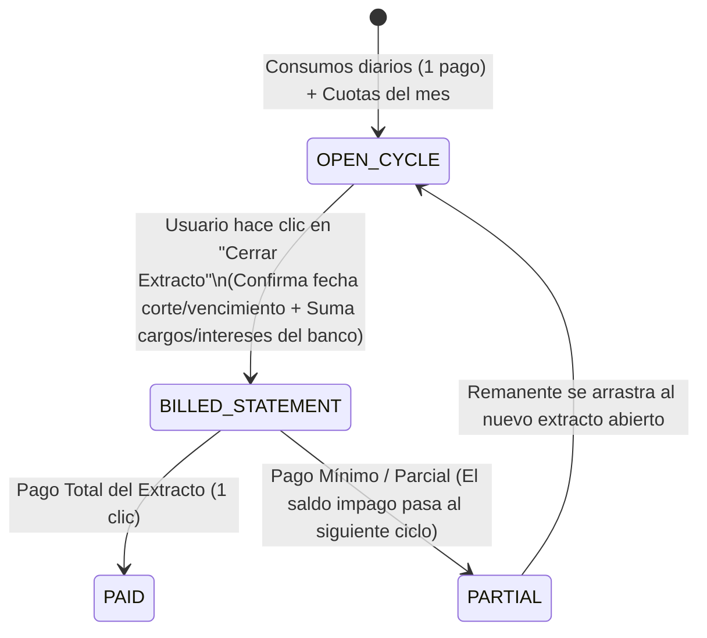
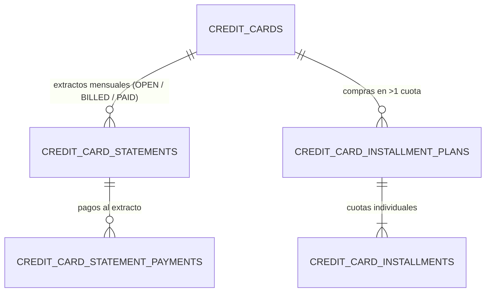

# Spec 03: Tarjetas de Crédito (Ciclos Variables, Extractos y Compras en Cuotas)

> **Realidad Operativa en Paraguay / LatAm:**  
> En la vida real, las fechas de cierre (_corte_) y vencimiento de los bancos no son siempre un día fijo inamovible (muchos bancos cierran por semana, ej. _"el 4to jueves del mes"_, o corren las fechas por feriados). Además, es en el **Extracto (Statement)** donde nacen los gastos financieros, seguros de deuda, cargos de mantenimiento e IVA del ciclo.  
> ContaWave no intenta adivinar las reglas internas del banco: le da al usuario un flujo natural donde **carga sus consumos día a día sin bloqueos** y, cuando sale su extracto, **cierra/concilia su extracto en 30 segundos** ajustando la fecha real y sumando los cargos bancarios del ciclo.

---

## 1. Cómo Funciona el Ciclo de Vida de una Tarjeta en ContaWave



### Etapa 1: Día a Día — Carga de Consumos desde Transacción Rápida

El usuario registra sus gastos cotidianos en la pantalla normal de **Transacción Rápida $\rightarrow$ Gasto**:

- Elige la categoría (ej. _Supermercado_, _Restaurantes_, _Vuelos_) y como medio de pago elige su **Tarjeta de Crédito** (ej. _Visa Itaú_).
- Al elegir una tarjeta, aparece un selector al lado del monto: **`[ En 1 pago ▾ ]`** _(o `2, 3, 6, 12, 18 cuotas`)_.

#### ¿Qué ocurre bajo el capó según la cantidad de pagos?

1. **Si elige `En 1 pago` (Consumo corriente):**
   - Genera el asiento contable inmediato: `Dr Supermercado / Cr Pasivo Visa Itaú`.
   - Ese consumo queda automáticamente asignado al **Ciclo Abierto (`OPEN`)** actual de la tarjeta.
2. **Si elige `En N cuotas` (ej. Notebook de ₲ 6.000.000 en 6 cuotas):**
   - **En el Ledger (Balance General):** Genera hoy el asiento por el total (`Dr Equipos 6M / Cr Pasivo Visa Itaú 6M`). Tu Patrimonio Neto y tu cupo disponible reflejan de inmediato que debes 6M.
   - **En el Subledger (`credit_card_installments`):** Divide los ₲ 6.000.000 en 6 cuotas de ₲ 1.000.000:
     - La **Cuota 1/6** entra al **Ciclo Abierto (`OPEN`)** actual.
     - Las **Cuotas 2/6 a 6/6** quedan agendadas para los 5 ciclos mensuales siguientes (no entran al resumen de este mes).

---

### Etapa 2: Fecha de Corte — "Cerrar Extracto del Mes" (30 segundos)

Mientras el ciclo está `OPEN`, ContaWave usa el día aproximado de cierre y vencimiento de la tarjeta para proyectar en el **Rolling Forecast** cuánto vas a tener que pagar.

Cuando el banco emite el extracto (o el usuario mira su app bancaria tras la fecha de corte), hace clic en **"Cerrar Extracto"**:

```text
┌──────────────────────────────────────────────────────────────────────────┐
│  📄 Cerrar Extracto — Visa Itaú                                     [×]  │
├──────────────────────────────────────────────────────────────────────────┤
│  1. Fechas reales de este extracto (ajustables según tu banco):          │
│     • Fecha de Corte:        [ 24/10/2026 ]                              │
│     • Fecha de Vencimiento:  [ 06/11/2026 ]  (Cuándo saldrá de tu caja)  │
│                                                                          │
│  2. Consumos y cuotas que entraron en este corte:                        │
│     [✓] 12/10 - Supermercado Casa Rica (1 pago)           ₲    450.000   │
│     [✓] 18/10 - Notebook (Cuota 1 de 6)                   ₲  1.000.000   │
│     [ ] 24/10 - Uber (Pasar al próximo extracto)          ₲     50.000   │
│     • Saldo anterior no pagado (arrastre):                ₲          0   │
│     ───────────────────────────────────────────────────────────────────  │
│     Subtotal de tus consumos:                             ₲  1.450.000   │
│                                                                          │
│  3. + Cargos bancarios nacidos en este extracto:                         │
│     • Intereses / Seguro / Mantenimiento / IVA:         [ ₲     65.000 ] │
│       (Categoría: Intereses y Cargos Financieros ▾)                      │
│     ───────────────────────────────────────────────────────────────────  │
│     TOTAL DEL EXTRACTO A PAGAR:                           ₲  1.515.000   │
│     Pago Mínimo informado por el banco (opcional):      [ ₲    150.000 ] │
│                                                                          │
│                                      [ Cancelar ]  [ Confirmar Extracto ]│
└──────────────────────────────────────────────────────────────────────────┘
```

#### ¿Qué resuelve este paso con cero fricción?

1. **Fechas variables de Paraguay:** No importa si este mes el banco cortó el 22 o el 26, ni si el vencimiento cayó el 4 o el 8. El usuario pone la fecha exacta de su extracto.
2. **Consumos en el borde del corte:** Si compró algo el mismo día de corte y el banco lo pateó para el mes siguiente, simplemente lo destilda y queda en el siguiente ciclo `OPEN`.
3. **Nacimiento contable de los cargos de tarjeta:** Si el banco sumó `₲ 65.000` de intereses, seguro de cancelación de deuda o mantenimiento en el extracto, al confirmar el extracto ContaWave **genera automáticamente el asiento de gasto** (`Dr Intereses y Cargos Financieros 65.000 / Cr Pasivo Visa Itaú 65.000`) con fecha del corte. Así el saldo contable de la tarjeta en el Balance General cuadra **al guaraní** con el extracto del banco.

---

### Etapa 3: Fecha de Vencimiento — "Pagar Extracto" en 1 Clic

Cuando llega el vencimiento (ej. `06/11/2026`), el usuario presiona **"Pagar Extracto"**:

- **¿Cuánto pagaste?** Precargado con el Total del Extracto (`₲ 1.515.000`), o un botón rápido para elegir el _Pago Mínimo_ (`₲ 150.000`) o escribir cualquier monto parcial.
- **¿De qué cuenta salió la plata?** Ej. _Banco Itaú_.
- **Impacto automático:**
  - Genera el asiento `Dr Pasivo Visa Itaú / Cr Banco Itaú`.
  - Registra la imputación en `credit_card_statement_payments`.
  - **Si pagó menos del total (ej. pagó `₲ 1.000.000` de `₲ 1.515.000`):** Los `₲ 515.000` no pagados quedan automáticamente como `previous_unpaid_balance` para el próximo extracto (y en el próximo cierre el usuario cargará los intereses rotativos que el banco le liquide sobre ese saldo).

---

## 2. Modelo de Datos Relacional (4 Tablas)



### 2.1 `credit_cards` (Ficha de la Tarjeta)

| Columna                | Tipo                      | Descripción                                                                     |
| :--------------------- | :------------------------ | :------------------------------------------------------------------------------ |
| `id`                   | `UUID` (PK)               | Identificador único                                                             |
| `user_id`              | `UUID` (FK `users.id`)    | Propietario                                                                     |
| `name`                 | `VARCHAR(100)`            | Ej. _"Visa Itaú"_                                                               |
| `liability_account_id` | `UUID` (FK `accounts.id`) | Cuenta de Pasivo asociada (`UNIQUE`)                                            |
| `default_closing_day`  | `INT` (`1..31`)           | Día aproximado de cierre (solo para estimar fechas de ciclos futuros)           |
| `default_due_day`      | `INT` (`1..31`)           | Día aproximado de vencimiento (solo para estimar fechas de ciclos futuros)      |
| `credit_limit`         | `NUMERIC(18, 4) NULL`     | Límite de crédito para calcular cupo disponible (`credit_limit - saldo_pasivo`) |
| `status`               | `VARCHAR(15)`             | `'ACTIVE'` \| `'INACTIVE'`                                                      |

### 2.2 `credit_card_statements` (Extractos Bancarios)

| Columna                      | Tipo                               | Descripción                                                                    |
| :--------------------------- | :--------------------------------- | :----------------------------------------------------------------------------- |
| `id`                         | `UUID` (PK)                        | Identificador único del extracto                                               |
| `credit_card_id`             | `UUID` (FK `credit_cards.id`)      | Tarjeta (`ON DELETE CASCADE`)                                                  |
| `statement_period`           | `VARCHAR(7)`                       | Mes de referencia del extracto (`YYYY-MM`)                                     |
| `closing_date`               | `DATE`                             | Fecha de corte (estimada mientras está `OPEN`, confirmada al pasar a `BILLED`) |
| `due_date`                   | `DATE`                             | Fecha de vencimiento de pago (en la que impacta el Rolling Forecast)           |
| `previous_unpaid_balance`    | `NUMERIC(18, 4)`                   | Saldo impago arrastrado del extracto anterior                                  |
| `billed_cycles_purchases`    | `NUMERIC(18, 4)`                   | Suma de consumos de 1 pago incluidos en este corte                             |
| `billed_installments_amount` | `NUMERIC(18, 4)`                   | Suma de cuotas `k/N` que vencen en este extracto                               |
| `financial_charges_amount`   | `NUMERIC(18, 4)`                   | Intereses, seguros y mantenimiento nacidos en el extracto                      |
| `charges_transaction_id`     | `UUID NULL` (FK `transactions.id`) | Asiento generado por los cargos bancarios al cerrar el extracto                |
| `total_amount`               | `NUMERIC(18, 4)`                   | Total exigible del extracto                                                    |
| `minimum_payment`            | `NUMERIC(18, 4)`                   | Pago mínimo informativo del extracto                                           |
| `status`                     | `VARCHAR(15)`                      | `'OPEN'` (En curso) \| `'BILLED'` (Cerrado/Emitido)                            |

### 2.3 `credit_card_statement_payments` (Pagos Aplicados al Extracto)

| Columna            | Tipo                                    | Descripción                                                     |
| :----------------- | :-------------------------------------- | :-------------------------------------------------------------- |
| `id`               | `UUID` (PK)                             | Identificador único                                             |
| `statement_id`     | `UUID` (FK `credit_card_statements.id`) | Extracto que se está pagando (`ON DELETE RESTRICT`)             |
| `transaction_id`   | `UUID` (FK `transactions.id`)           | Asiento contable `Dr Tarjeta / Cr Banco` (`ON DELETE RESTRICT`) |
| `journal_entry_id` | `UUID` (FK `journal_entries.id`)        | Línea exacta del asiento que debitó `liability_account_id`      |
| `amount`           | `NUMERIC(18, 4)`                        | Monto pagado (`> 0`)                                            |
| `paid_at`          | `DATE`                                  | Fecha efectiva del pago                                         |

### 2.4 `credit_card_installment_plans` & `credit_card_installments` (Compras en Cuotas)

- **`credit_card_installment_plans`**: Guarda `id`, `credit_card_id`, `purchase_transaction_id` (`ON DELETE CASCADE`), `description`, `total_amount`, `installments_count`, `purchase_date`.
- **`credit_card_installments`**: Guarda cada cuota (`1..N`) con `plan_id`, `installment_number`, `target_statement_period` (`YYYY-MM`), `amount`, y `statement_id NULL` (se vincula al extracto cuando ese ciclo se cierra).

---

## 3. Cómo Alimenta al Rolling Forecast (`ScheduledCashFlowItem`)

El adaptador `CreditCardCashFlowAdapter` proyecta la salida de caja de cada tarjeta en tres capas limpias sin distorsionar jamás el mes siguiente con el pasivo total de las cuotas futuras:

1. **Si hay un Extracto Cerrado (`status = 'BILLED'`) pendiente de pago:**
   - Emite un `ScheduledCashFlowItem` en la fecha exacta `statement.due_date` por el saldo pendiente del extracto (`statement.total_amount - SUM(payments)`).
2. **Para el Ciclo Abierto Actual (`status = 'OPEN'`):**
   - Emite un `ScheduledCashFlowItem` en la fecha de vencimiento estimada del ciclo abierto por:
     $$\text{Proyección Ciclo Abierto} = \text{Saldo Anterior Impago} + \text{Consumos de 1 pago del ciclo} + \text{Cuotas de Tarjeta que caen en este ciclo}$$
3. **Para los Meses Futuros ($M+1, M+2, \dots$):**
   - Agrupa todas las cuotas de `credit_card_installments` que caen en cada mes futuro y emite un `ScheduledCashFlowItem` en la fecha estimada de vencimiento (`default_due_day`) de cada mes.
   - _(Y a la vez, absorbe cualquier presupuesto extra de uso de tarjeta que el usuario haya planeado para esos meses)._
